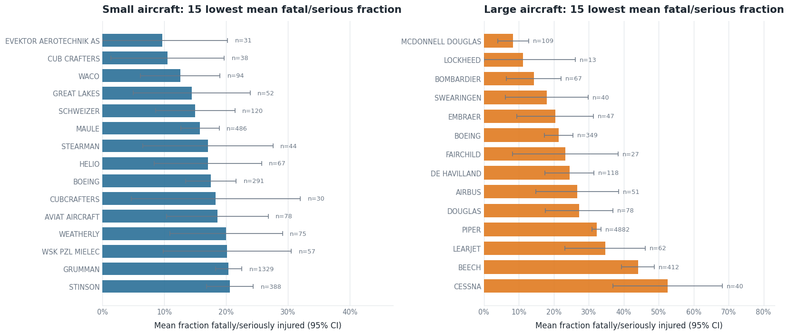
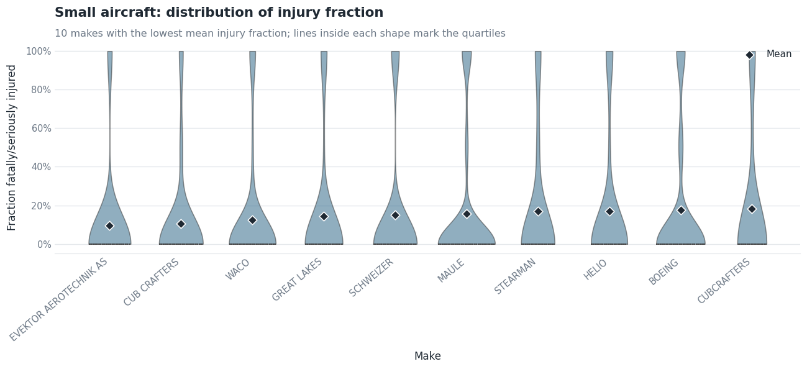
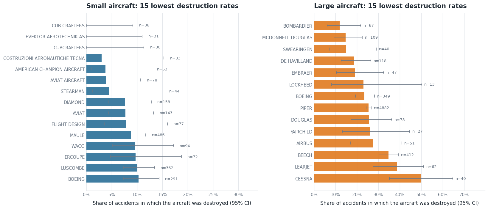
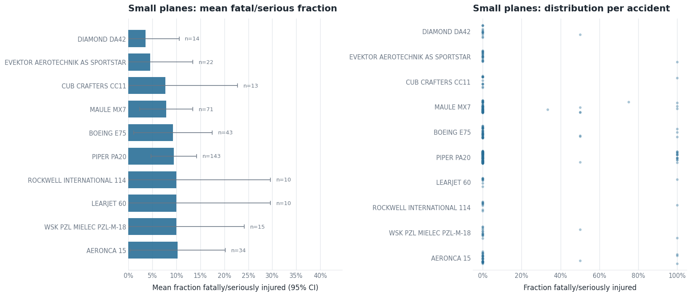
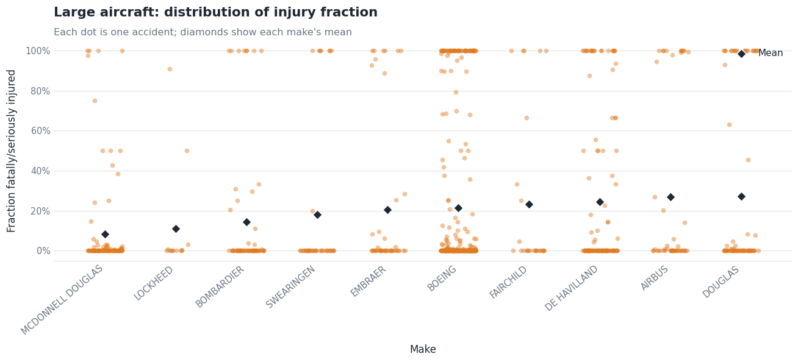
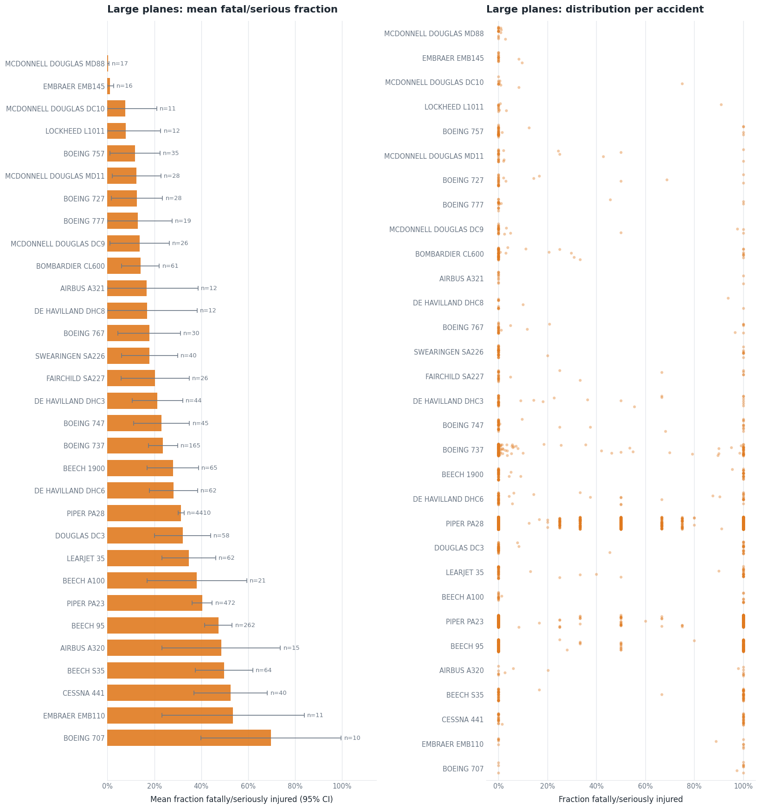
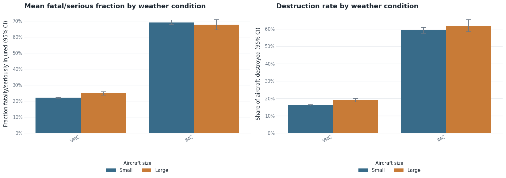
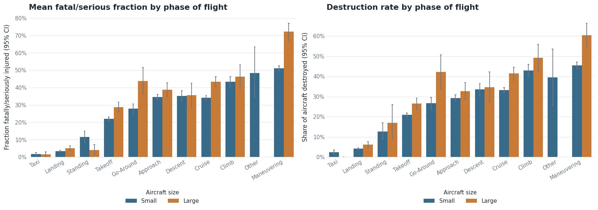
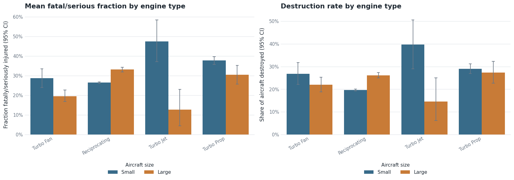
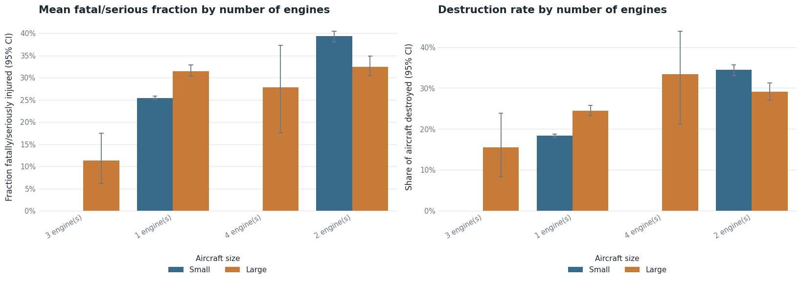

# Jet Airline Safety Data Analysis

> **Project Goal:** To analyze aviation accident data and provide actionable recommendations to an aviation insurer regarding the safest commercial and passenger jet aircraft makes and models.

## Table of Contents
* [Business Understanding](#business-understanding)
* [Data Overview](#data-overview)
* [Methodology](#methodology)
* [Key Findings & Visualizations](#key-findings--visualizations)
* [Conclusions & Recommendations](#conclusions--recommendations)
* [Repository Structure](#repository-structure)

## Business Understanding
We have been tasked by a prominent airline/airplane insurer to conduct a comprehensive analysis of commercial and passenger jet airline safety. The client's primary objective is to identify which types of aircraft exhibit the lowest rates of total destruction and the lowest likelihood of fatal or serious passenger injuries in the event of an accident.

Additionally, the client is interested in understanding general variables and conditions that contribute to aviation accidents.

### Key Project Parameters

| Parameter | Constraint |
| :--- | :--- |
| **Timeframe** | Data analysis is restricted to aircraft from **1983 onwards** (assuming a 40-year maximum lifetime for aircraft retirement). |
| **Aircraft Type** | Analysis is limited to active, **professionally built** aircraft only. |
| **Scope** | Provide separate recommendations for **small aircraft** versus **larger passenger models**. |
| **Statistical Rigor** | Claims and comparisons between groups must be statistically robust and backed by adequate sample sizes. |

## Data Overview
The analysis utilizes aviation accident data initially spanning from 1948 to 2023.

* **Data Cleaning:** Raw data was cleaned and filtered to include only professional builds from 1983-2023. Missing values were handled systematically, and relevant columns were transformed to create accurate safety measures.
* **Prepared Dataset:** The cleaned dataset (54,163 accidents) is exported and used as the foundation for the exploratory data analysis phase.
* **Outcome measures:** (1) the *fatal/serious fraction*, the share of people aboard who were fatally or seriously injured in an accident, and (2) the *destroyed rate*, the share of accidents in which the aircraft was destroyed. Overall, the mean fatal/serious fraction is 27.5% and 20.8% of aircraft were destroyed.
* **Small vs. large:** a plane type (make + model family) is classed as *Large* if any of its accidents had more than 20 people aboard, otherwise *Small*.

## Methodology
The project is divided into two main phases, documented across two Jupyter Notebooks:

### 1. Data Cleaning (`Aviation_Accident_Cleaning.ipynb`)
* Loaded and inspected the raw dataset using Pandas.
* Cleaned the data by filtering for the post-1983 timeframe and removing amateur builds.
* Exported the cleaned, analysis-ready dataset to a `.csv` file.

### 2. Exploratory Data Analysis (`Aviation_Accident_Data_Analysis.ipynb`)
* Conducted Exploratory Data Analysis (EDA) using statistical summary methods and the split-apply-combine paradigm (`groupby`).
* Utilized Seaborn and Matplotlib, with a shared set of chart presets, for statistical visualizations to identify trends in passenger injuries and aircraft damage.
* Reported a sample size and 95% confidence interval for every comparison, and excluded makes/types with fewer than 10 accidents (30 per category for the factor comparisons).
* Evaluated external factors and conditions contributing to airplane safety outcomes: weather condition, phase of flight, engine type and number of engines.

## Key Findings & Visualizations

Benchmarks: all small aircraft have a fatal/serious fraction of **27.0%** and a destroyed rate of **20.1%**; all large aircraft have **31.5%** and **25.7%**.

### 1. Safest Small Aircraft
**Summary:**
Maule is the best-supported small make: with 486 accidents it has a 15.8% fatal/serious fraction and an 8.8% destroyed rate, both clearly below the small-aircraft benchmark. Cub Crafters (68 accidents across two spellings, none destroyed), Evektor Aerotechnik (n=31: 9.7%, 0% destroyed) and Waco (n=94: 12.6%, 9.6%) also rank well but on smaller samples. Among specific types, Maule MX7 (n=71: 7.9%, 1.4% destroyed) and Piper PA20 (n=143: 9.4%, 6.3% destroyed) have the strongest evidence.

**Visual Evidence:**









### 2. Safest Large Passenger Models
**Summary:**
McDonnell Douglas (n=109: 8.4% fatal/serious, 14.7% destroyed) and Bombardier (n=67: 14.3%, 11.9% destroyed) are clearly below the large-aircraft benchmark, and Boeing (n=349: 21.5%, 23.5%) is a solid large-sample option. By type, McDonnell Douglas MD88 (n=17) and Embraer EMB145 (n=16) rank best with almost no fatal/serious injuries and no destroyed aircraft, but on very few accidents, while Bombardier CL600 (n=61), Boeing 757 (n=35) and Boeing 727 (n=28) have more dependable evidence. Note that some light aircraft (for example Piper PA28) are classed as "Large" because of records with more than 20 people aboard, which inflates the large benchmark.

**Visual Evidence:**





### 3. Factors Influencing Airplane Safety
* **Factor 1 (Weather condition):** Accidents in instrument conditions (IMC) are far more severe than in visual conditions (VMC). For small aircraft, 69.1% of occupants were fatally or seriously injured in IMC versus 22.0% in VMC, with 59.2% versus 16.0% of aircraft destroyed; large aircraft show the same pattern (67.6% vs. 24.8%; 61.8% vs. 19.0% destroyed). Differences are statistically significant (p < 0.0001).
* **Factor 2 (Phase of flight):** Maneuvering is the most severe phase (small 51.1%, large 72.2% fatal/serious), followed by climb and cruise. Landing and taxi are the most survivable (3.4% and 1.7% for small aircraft), even though landing is the most frequent phase for small aircraft accidents. Phase is missing for about 29.5% of records.
* **Additional factors (engines):** Small twin-engine aircraft (39.3% fatal/serious) and small turbine-powered aircraft (turbo prop 37.7%) do worse than small single-engine piston aircraft (25.5%); large turbo fan aircraft are the best large group (19.6%). These are associations tied to the type of flying involved, not proof of cause.

**Visual Evidence:**









## Conclusions & Recommendations
Based on the data analysis, we recommend the insurer consider the following for favorable risk profiles:

* **Small Aircraft Recommendations:**
  * **Maule** (make) and **Maule MX7** (type): n=486, 15.8% fatal/serious, 8.8% destroyed; MX7 n=71, 7.9% and 1.4%. Strongest evidence.
  * **Cub Crafters / Evektor Aerotechnik / Waco** (makes): low injury and destruction rates on smaller samples. Diamond DA42, Evektor Sportstar and Cub Crafters CC11 look excellent but need more accident data.
  * **Piper PA20** (type): n=143, 9.4% fatal/serious, 6.3% destroyed.

* **Large Aircraft Recommendations:**
  * **McDonnell Douglas** (make) and **Bombardier** (make): both clearly better than the large-aircraft benchmark (8.4% / 14.7% and 14.3% / 11.9%).
  * **Bombardier CL600, Boeing 757 and Boeing 727** (types): reasonable samples with 11% to 14% fatal/serious. **McDonnell Douglas MD88 and Embraer EMB145** rank best but rest on 16 to 17 accidents, so treat them as promising.
  * **Use caution with:** Beech, Cessna and Learjet makes, Boeing 707, and Airbus A320 (small sample).

* **Risk Factors to Monitor:**
  * **Instrument conditions (IMC):** roughly three times the injury rate and more than three times the destruction rate of visual conditions, for both small and large aircraft.
  * **Maneuvering, climb and cruise phases:** the most severe phases; landing and taxi are frequent but rarely serious.
  * **Twin-engine and turbine small aircraft:** worse outcomes than single-engine piston small aircraft (association only).

**Limitations:** rates are *given that an accident occurred* (no flight-hour data), so they are not overall crash risk. Some factor columns have missing values, many top-ranked types sit close to the 10-accident minimum, and the "Large" group includes light aircraft because of records with more than 20 people aboard. Spelling variants (such as CUB CRAFTERS and CUBCRAFTERS) should be merged in a future cleaning pass.

## Repository Structure

```text
├── data/
│   ├── raw_aviation_data.csv             # Original dataset
│   └── AviationData_cleaned.csv          # Cleaned dataset exported from Part 1
├── images/
│   ├── eda_overview.png                  # Exported charts used in this README
│   ├── makes_fatal_serious.png
│   ├── small_makes_violin.png
│   ├── large_makes_strip.png
│   ├── makes_destroyed.png
│   ├── types_small.png
│   ├── types_large.png
│   ├── factor_weather.png
│   ├── factor_phase_of_flight.png
│   ├── factor_engine_type.png
│   └── factor_number_of_engines.png
├── Aviation_Accident_Cleaning.ipynb      # Phase 1: Data cleaning process
├── Aviation_Accident_Data_Analysis.ipynb # Phase 2: EDA and statistical analysis
└── README.md                             # Project presentation and summary
```